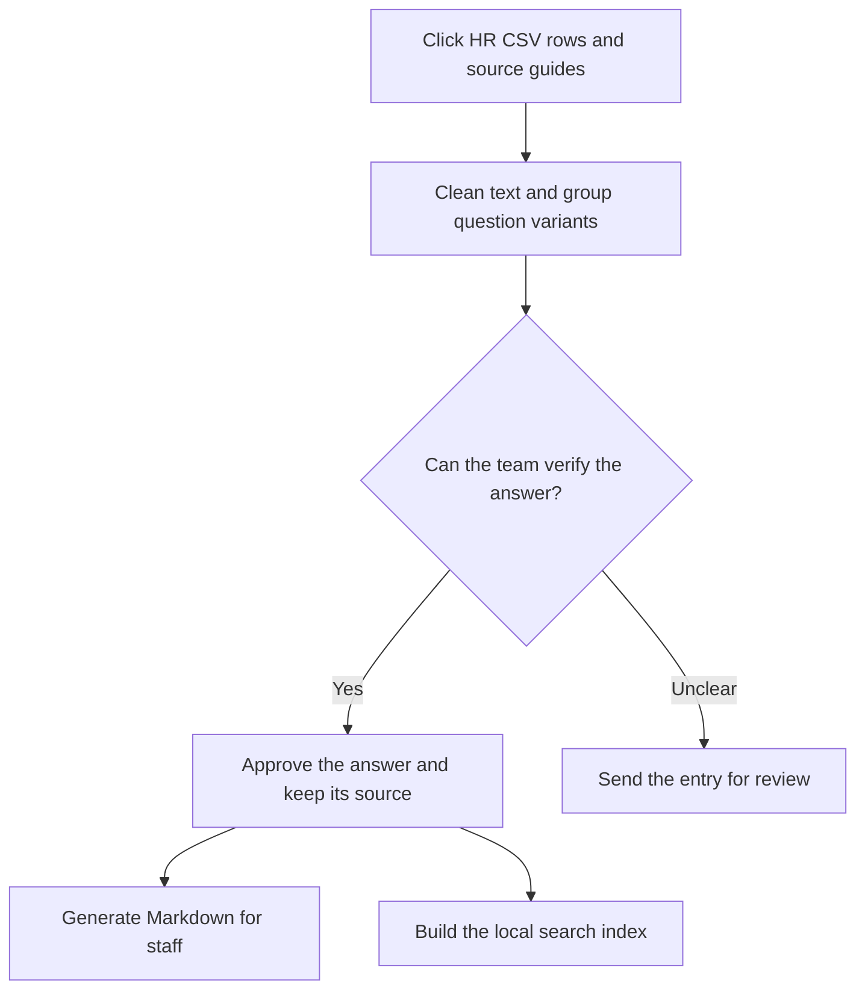
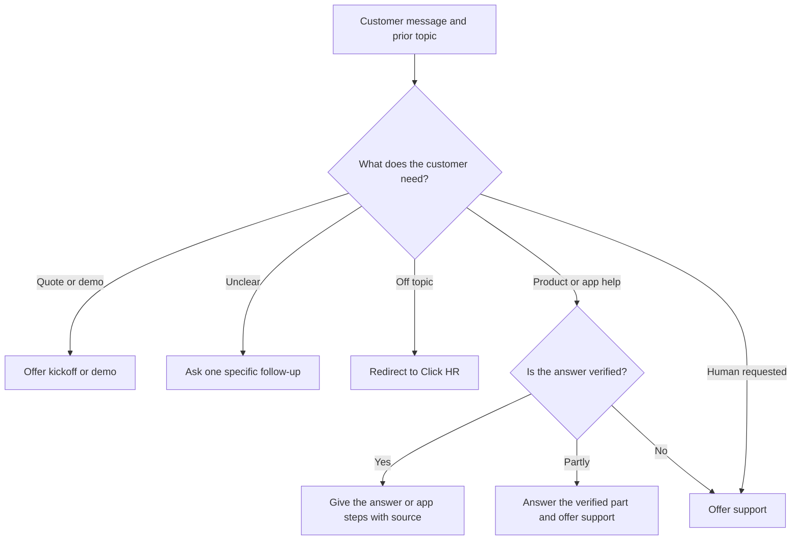

# Navi for Click HR

Navi helps customers understand what Click HR offers and shows them how to use it. It answers from verified product information, asks for clarification when needed, offers support when a detail needs confirmation, and sends quote requests to sales. The free version runs locally without a model API key.

## Start with the version you can run today

The GitHub version already includes a bilingual FAQ engine, a browser playground, an API demo, support links, and an inbox for kickoff requests. It can guide users to **Leave → AL** in the mobile app. The approved CSV importer, expanded search, and dedicated support-ticket inbox are proposed work. The 36 cases below are a test plan. Their results are still unmeasured.

In the repository folder, run the following with Node.js 24 or newer.

```bash
npm run start:free
```

Open the [Navi Playground](http://127.0.0.1:3000/) to try the chat or the [API demo](http://127.0.0.1:3000/api-demo) to see the JSON response. Use the [repository setup guide](https://github.com/unbu-man/Navi-Structure-for-Another-Company#free-api-and-browser-demo) if you still need to get the project.

## Prepare the knowledge



1. **Use the Click HR rows from your existing CSV first.** Keep the source document and section or URL. Collect more material where the team finds a real gap.
2. **Assign a stable answer ID.** Give equivalent English, Khmer, and mixed-language questions the same ID. Two questions that need different steps or policies get different IDs, even if their wording is similar.
3. **Clean for search and preserve the display text.** Normalize Khmer and whitespace for matching. Keep the original approved answer for the customer. Review conflicting sources, missing translations, and app steps that vary by platform or role.
4. **Keep the cleaned CSV as the master copy.** Generate Markdown from it so staff can read and review the entries. Index the approved records from the same CSV in local SQLite. Start by ranking question variants with keywords and character n-grams. Filter by company before ranking.
5. **Keep policies in the API.** A match in the dataset can supply facts or app steps. The quote-after-kickoff rule still controls pricing replies.

A practical published entry needs these fields.

| Field | Example |
|---|---|
| Company and stable answer ID | `clickhr`, `leave-balance-mobile` |
| Questions and matching phrases | “Where can I see my leave balance?” and its verified Khmer and mixed-language variants |
| Approved answers | The same task explained in English and Khmer |
| Source and applicability | A guide or screenshot, plus platform, role, or version when relevant |
| Approval | Review status and date checked |

## Handle the conversation



This is the target flow. The 12 situations below are customer scenarios. The six response types are **verified answer, clarification, support, sales kickoff, demo, and off-topic redirect**. A partial answer can combine a verified answer and a support offer.

- **Product support** handles feature behavior, troubleshooting, and unverified compatibility. If a guide covers part of the request, answer that part and state which detail still needs confirmation.
- **Company HR** handles private employee records or balances missing in a customer’s account. For self-service, show where to look. For example, **Click HR mobile app → Leave → AL** shows where to check annual leave. The publicly available screenshots are for iOS. Verify the exact steps for the app versions you support. [Click HR app listing](https://apps.apple.com/kh/app/clickhr/id6499134021)
- **Sales** handles pricing and demos. A quote request offers a kickoff to review requirements. An explicit demo request offers booking. An inbox submission leaves the meeting time pending until staff confirm it.
- **Support feedback** starts with the existing support link. When you add ticket submission, let the customer confirm the question, relevant details, and contact method before saving. Staff can turn a reusable verified answer into a new approved CSV entry.

## Test the 12 situations with 36 questions

For each case, compare the reply against the expected action. In a spreadsheet or CSV, record `case_id`, `language`, `expected_action`, `actual_action`, `source_or_steps_correct`, `pass`, and a short note. Use a fresh chat for each row except cases 31–33, which use the indicated preceding topic.

| ID | Situation | Language | Customer message | Expected behavior |
|---:|---|---|---|---|
| 1 | Product | English | What does Click HR do? | Explain its core HR features with a source. |
| 2 | Product | Khmer | តើ Click HR អាចគ្រប់គ្រងវត្តមានបុគ្គលិកបានទេ? | Explain attendance in Khmer with a source. |
| 3 | Product | Mixed | Click HR មាន payroll និង NSSF ទេ? | Explain the verified payroll and NSSF features. |
| 4 | How-to | English | How do I request annual leave in the app? | Give verified leave-request steps. Offer support if detailed steps are missing. |
| 5 | How-to | Khmer | តើខ្ញុំត្រូវកត់ត្រាម៉ោងចូលធ្វើការតាមទូរស័ព្ទយ៉ាងដូចម្តេច? | Give verified mobile clock-in steps. |
| 6 | How-to | Mixed | តើខ្ញុំអាច submit OT request នៅឯណា? | Explain where to submit overtime if the path is verified. |
| 7 | Personal self-service | English | How much annual leave do I have left? | Show Leave → AL. Keep the actual balance in the signed-in app. |
| 8 | Personal self-service | Khmer | តើខ្ញុំអាចមើលបង្កាន់ដៃប្រាក់ខែរបស់ខ្ញុំនៅឯណា? | Give a verified payslip path or direct the customer to company HR. |
| 9 | Personal self-service | Mixed | ខ្ញុំចង់ check my leave balance។ | Show Leave → AL and keep the actual balance in the app. |
| 10 | Troubleshooting | English | I can’t clock in on my phone. | Ask what happens when they try, then use verified troubleshooting guidance. |
| 11 | Troubleshooting | Khmer | ខ្ញុំចូលគណនីមិនបានទេ។ | Ask what error appears or direct to authorized support. Keep credentials out of chat. |
| 12 | Troubleshooting | Mixed | OT request ខ្ញុំ submit ហើយវា error។ | Ask for the error and offer support if the cause stays unclear. |
| 13 | Vague | English | It doesn’t work. | Ask which feature and task the customer means. |
| 14 | Vague | Khmer | សូមជួយខ្ញុំផង។ | Ask what they want to do in Click HR. |
| 15 | Vague | Mixed | App មាន problem។ | Ask what happens and where. |
| 16 | Partial answer | English | Can I request leave on a phone, and can two managers approve it? | Confirm mobile leave requests and offer support for the approval setup. |
| 17 | Partial answer | Khmer | តើអាចកត់ត្រាវត្តមានតាមទូរស័ព្ទបានទេ ហើយអាចភ្ជាប់ជាមួយឧបករណ៍ស្កេនគ្រប់ម៉ូដែលទេ? | Confirm mobile attendance and offer to verify a specific device. |
| 18 | Partial answer | Mixed | គាំទ្រ payroll ទេ ហើយអាច sync ជាមួយ QuickBooks ទេ? | Confirm payroll and offer support to verify QuickBooks compatibility. |
| 19 | Missing detail | English | Does Click HR work with the ZKTeco K40? | Say the model needs verification and offer support. |
| 20 | Missing detail | Khmer | តើអ្នកគ្រប់គ្រងតួនាទីណាខ្លះអាចកែប្រែកិច្ចសន្យាបុគ្គលិក? | Offer support to confirm role permissions. |
| 21 | Missing detail | Mixed | Click HR អាច integrate ជាមួយ custom HR system របស់យើងទេ? | Offer support to assess the integration. |
| 22 | Pricing | English | How much is Click HR for 50 employees? | Offer a kickoff without stating an amount. |
| 23 | Pricing | Khmer | តើតម្លៃប្រើប្រាស់ Click HR សម្រាប់បុគ្គលិក ១០០ នាក់ប៉ុន្មាន? | Offer a kickoff in Khmer. |
| 24 | Pricing | Mixed | Click HR មាន monthly fee ប៉ុន្មានសម្រាប់ក្រុមហ៊ុនខ្ញុំ? | Offer a kickoff. |
| 25 | Demo | English | Can someone show our HR team how it works? | Offer a demo or booking. |
| 26 | Demo | Khmer | ខ្ញុំចង់ណាត់ជួបដើម្បីមើលការបង្ហាញប្រព័ន្ធ។ | Offer a demo in Khmer. |
| 27 | Demo | Mixed | ចង់ book a demo សម្រាប់ក្រុម HR យើង។ | Offer the demo option. |
| 28 | Human support | English | Can I talk to a person? | Provide the support channel directly. |
| 29 | Human support | Khmer | តើខ្ញុំអាចទាក់ទងក្រុមជំនួយបានយ៉ាងដូចម្តេច? | Provide the support channel in Khmer. |
| 30 | Human support | Mixed | សុំ contact support team មួយបានទេ? | Offer direct support contact. |
| 31 | Follow-up | English | Where is that menu? *(After discussing where to view leave.)* | Use the prior topic to show the menu, or clarify if the menu remains ambiguous. |
| 32 | Follow-up | Khmer | ចុះបើបុគ្គលិក ១៥០ នាក់វិញ? *(After a price question.)* | Continue to offer a kickoff. |
| 33 | Follow-up | Mixed | ចុះ demo ត្រូវកក់នៅឯណា? *(After discussing demos.)* | Give the demo booking option. |
| 34 | Off topic | English | I go to schol. | Briefly steer the conversation back to Click HR. |
| 35 | Off topic | Khmer | ថ្ងៃនេះអាកាសធាតុយ៉ាងម៉េច? | Redirect to Click HR help. |
| 36 | Off topic | Mixed | How much ត្រូវចំណាយដើម្បីទិញ Bitcoin? | Redirect to Click HR help without sending the question to sales. |

Pass a case when both the action and the answer are appropriate. For example, a leave reply with the right intent but wrong menu steps fails. Record the current API’s results before changing it. Reuse these 36 cases to catch regressions, then keep a second set of fresh questions for your final evaluation. Compare **verified answer accuracy**, **Recall@3** for FAQ search, and **pricing precision and recall**. Track results by English, Khmer, and mixed phrasing so failures are easy to locate.

## Build in this order

| Stage | Deliverable | Check before moving on |
|---|---|---|
| 1 | Local API and baseline results | Try product, leave-balance, quote, and fallback examples. Record the 36-case results. |
| 2 | Approved Click HR CSV and Markdown review copy | Every published entry has a stable answer ID and a traceable source. |
| 3 | Company-scoped search over the full question variants | Verify answer IDs, source links, and safe fallback on weak matches. |
| 4 | More verified app guides and support handoff | Test the common tasks first. Confirm the correct team receives each type of request. |
| 5 | Fresh evaluation before customer use | Recheck app steps and compare the updated API with the baseline. |

**Start today** by running the free API and recording results for a product question, a leave balance question, a quote request, and an off-topic message. Keep that baseline so you can see what your CSV and better search actually improve.
